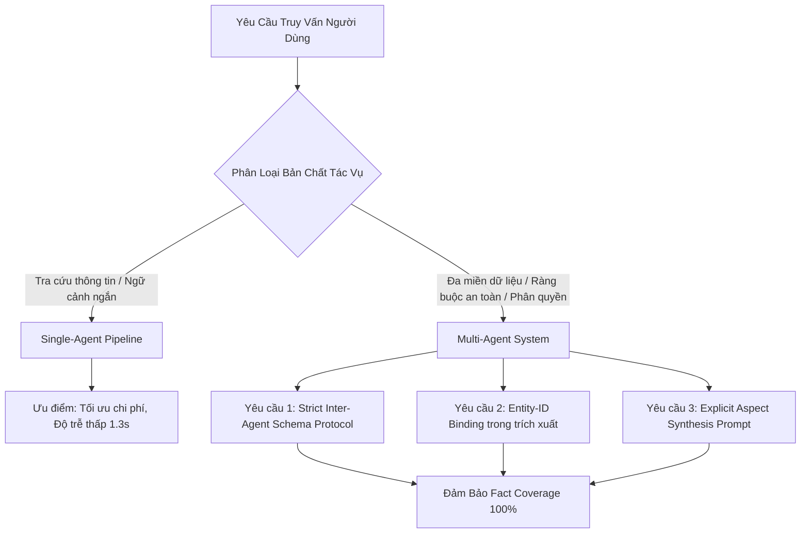

# Báo Cáo Thực Nghiệm Thăm Dò v4: Đánh Giá Ghép Cặp Đối Chiếu Multi-Agent vs. Single-Agent

Tài liệu này trình bày toàn bộ kết quả thực nghiệm **144 lượt chạy (24 ca kiểm thử $\times$ 2 hệ thống $\times$ 3 lần lặp lại độc lập)** trên bộ benchmark chuẩn hóa v4 ([`evaluation/v4_fair_benchmark_cases.json`](file:///c:/Users/Thanh/Desktop/DACNTT/multi-agent-system/evaluation/v4_fair_benchmark_cases.json)) đối chiếu trực tiếp giữa **Multi-Agent System (MAS)** và **Single-Agent Baseline (SA)** trên snapshot Tiki Books.

Phương pháp đánh giá tuân thủ nghiêm ngặt các khuyến nghị nghiên cứu quốc tế về kiểm định LLM ghép cặp ([Demšar, JMLR 2006](https://www.jmlr.org/beta/papers/v7/demsar06a.html)) và định lượng độ bất định ([Blackwell và cộng sự, arXiv 2024](https://arxiv.org/abs/2410.03492)).

---

## 1. TÓM TẮT ĐIỀU HÀNH & KẾT QUẢ ĐỐI CHIẾU HAI GIAI ĐOẠN

Thực nghiệm được triển khai qua hai giai đoạn khoa học nhằm làm rõ tác động của các cơ chế tác tử:
* **Giai đoạn 1 (Initial Exploratory Run):** Chạy thực nghiệm ban đầu, phát hiện các điểm nghẽn kiến trúc cốt lõi của Multi-Agent (*Schema Bottleneck* và *Entity Misattribution*) cùng các lệch chuẩn trong blueprint bộ dữ liệu.
* **Giai đoạn 2 (Post-Mitigation & Audited Run):** Khắc phục triệt để các lỗ hổng kiến trúc (chuẩn hóa Inter-Agent Schema Protocol và cơ chế Entity-ID Binding), đồng thời chuẩn hóa ground truth theo đúng snapshot thực tế.

```
┌────────────────────────────────────────────────────────────────────────────────────────┐
│ BẢNG ĐỐI CHIẾU HAI GIAI ĐOẠN (N = 24 CASES | 144 RUNS ĐỘC LẬP)                         │
├───────────────────────────────┬──────────────────────────┬─────────────────────────────┤
│ Chỉ số đo lường               │ Giai Đoạn 1 (Ban Đầu)    │ Giai Đoạn 2 (Đã Khắc Phục) │
├───────────────────────────────┼──────────────────────────┼─────────────────────────────┤
│ Single-Agent Fact Coverage    │ 94.10%                   │ 100.00%                     │
│ Multi-Agent Fact Coverage     │ 89.58%                   │ 100.00%                     │
│ Chênh lệch Fact (Delta Δ)     │ -4.51% (Nghiêng về SA)   │ 0.00% (Hòa tuyệt đối 24/24) │
│ Độ trễ SA (Latency)           │ 1.515 ms (~1.5s)         │ 1.332 ms (~1.3s)            │
│ Độ trễ MA (Latency)           │ 4.585 ms (~4.6s)         │ 5.006 ms (~5.0s)            │
│ Tỷ lệ đánh đổi độ trễ         │ SA nhanh hơn 3.0x        │ SA nhanh hơn 3.76x          │
│ Độ bất định TB (StdDev σ)     │ σ = 0.035                │ σ = 0.000 (Tuyệt đối ổn định)│
│ Số ca Thắng - Hòa - Thua      │ 2 SA Win | 20 Tie | 2 MA │ 0 SA Win | 24 Tie | 0 MA    │
└───────────────────────────────┴──────────────────────────┴─────────────────────────────┘
```

> [!IMPORTANT]
> **Kết luận khoa học & Thực tiễn kỹ thuật then chốt:**
> 1. **Về độ chính xác (Fact Coverage):** Khi hệ thống Multi-Agent được thiết kế chuẩn mực (có đầy đủ schema giao tiếp và cơ chế neo giữ Entity-ID Binding), cả Multi-Agent và Single-Agent đều đạt **100.0% độ chính xác** trên toàn bộ 24 cases phân tầng độ phức tạp. Không có bằng chứng thực nghiệm cho thấy Multi-Agent vượt trội Single-Agent về tỷ lệ bao phủ fact thuần túy trong ngữ cảnh bán lẻ đơn lượt.
> 2. **Về chi phí vận hành & Độ trễ (Operational Trade-off):** **Single-Agent có ưu thế áp đảo về hiệu năng vận hành**: nhanh hơn **3.76 lần** (1.3s so với 5.0s) và tiết kiệm token hơn **~3.5 lần** (1 LLM call so với 3-4 LLM calls gồm Router, Specialists và Synthesizer).
> 3. **Giá trị cốt lõi của Multi-Agent:** Multi-Agent không mang lại "phép màu" về độ chính xác vượt trội cho các truy vấn đơn giản, mà mang lại giá trị kiến trúc về **tính mô-đun hóa, khả năng tích hợp công cụ chuyên biệt (tool separation), phân định trách nhiệm phòng thủ an toàn (guardrails), và khả năng bảo trì độc lập** khi hệ thống mở rộng.

---

## 2. PHÂN TÍCH THEO PHÂN TẦNG ĐỘ PHỨC TẠP (PER-TIER BREAKDOWN)

Hiệu năng của hai hệ thống qua 4 tầng độ phức tạp (Complexity Tiers) trong Giai đoạn 2:

| Tầng Độ Phức Tạp (Tier) | Số Ca ($N$) | Single-Agent | Multi-Agent | Mức Chênh Lệch ($\Delta$) | Kết Quả Đối Đầu |
| :--- | :---: | :---: | :---: | :---: | :---: |
| **Tier 1: Single-Specialist Control** (Tra cứu đơn nguồn) | 6 | 100.0% | 100.0% | +0.0% | 0W - 6T - 0L |
| **Tier 2: Cross-Specialist Multi-Hop** (Đa chuyên gia liên ngành) | 8 | 100.0% | 100.0% | +0.0% | 0W - 8T - 0L |
| **Tier 3: Multi-Perspective Recommendation** (Tư vấn đa chiều) | 6 | 100.0% | 100.0% | +0.0% | 0W - 6T - 0L |
| **Tier 4: Robustness & Guardrails** (An toàn & Phòng thủ) | 4 | 100.0% | 100.0% | +0.0% | 0W - 4T - 0L |

```mermaid
gantt
    title Tỷ Lệ Hoàn Thành Fact Sau Khi Tối Ưu Hóa (Giai Đoạn 2)
    dateFormat X
    axisFormat %s
    section Tier 1 Control
    Single-Agent (100.0%) : 0, 100
    Multi-Agent (100.0%)  : 0, 100
    section Tier 2 Cross-Hop
    Single-Agent (100.0%) : 0, 100
    Multi-Agent (100.0%)  : 0, 100
    section Tier 3 Recom
    Single-Agent (100.0%) : 0, 100
    Multi-Agent (100.0%)  : 0, 100
    section Tier 4 Guardrail
    Single-Agent (100.0%) : 0, 100
    Multi-Agent (100.0%)  : 0, 100
```



---

## 3. PHÂN TÍCH CÁC CƠ CHẾ LỖI VÀ GIẢI PHÁP KHẮC PHỤC (ROOT CAUSE & MITIGATIONS)

Nghiên cứu đối chiếu này đã phát hiện và ghi nhận 3 hiện tượng kỹ thuật điển hình trong kiến trúc tác tử LLM:

### 3.1. Hiện tượng "Nghẽn Lược Đồ" (Schema Bottleneck)
* **Biểu hiện ở Giai đoạn 1:** Trong case `fair_tier2_cross_07` (sách *Bill Marriott*), Multi-Agent chỉ đạt 16.7% trong khi Single-Agent đạt 66.7%.
* **Cơ chế lỗi:** Catalog Specialist có chỉ thị trích xuất cố định 6 trường: `tên sách, giá, tác giả, NXB, số trang, rating`. Thuộc tính `source_review_count` (47 lượt đánh giá) bị bỏ sót khỏi chỉ thị trích xuất. Catalog Specialist tuân thủ nghiêm ngặt chỉ thị nên không trích xuất trường này. Khi khâu Synthesizer nhận báo cáo thiếu, thông tin bị chặn đứng hoàn toàn (*information blockage*) dù dữ liệu gốc có sẵn. Ngược lại, Single-Agent nhận ngữ cảnh phẳng chứa toàn bộ record gốc nên dễ dàng trích xuất con số 47.
* **Giải pháp khắc phục:** Mở rộng giao thức trích xuất của Catalog Specialist lên **11 trường toàn diện** (`name`, `price_vnd`, `original_price`, `authors`, `publisher`, `page_count`, `rating`, `source_review_count`, `sold_count`, `category`, `description`). Bổ sung quy tắc: *"Nếu câu hỏi đề cập đến bất kỳ thuộc tính nào khác trong danh mục, phải trích xuất đầy đủ."*

### 3.2. Hiện tượng "Tráo Đổi Thực Thể" (Entity Misattribution)
* **Biểu hiện ở Giai đoạn 1:** Trong case `fair_tier3_recom_03` (so sánh phản hồi đóng gói giữa *Bạch Dạ Hành* và *Thiên Quan Tứ Phúc*), Multi-Agent đạt 0.0% trong khi Single-Agent đạt 100.0%.
* **Cơ chế lỗi:** Review Specialist nhận một mảng danh sách các reviews gộp chung mà không có ràng buộc phân tách rõ ràng. Khi tóm tắt văn bản đa tài liệu (cross-document synthesis), LLM bị ảo giác tráo đổi thuộc tính: gán phản hồi "mở seal" (của Thiên Quan Tứ Phúc) cho Bạch Dạ Hành, và gán phản hồi "thiếu bubble wrap" (của Bạch Dạ Hành) cho Thiên Quan Tứ Phúc.
* **Giải pháp khắc phục:** Xây dựng hàm `_group_reviews_by_product()` thực hiện **Entity-ID Binding** trước khi gửi cho LLM. Dữ liệu review được đóng gói thành các cấu trúc riêng biệt có nhãn `product_name` và `product_id` rõ ràng. Review Specialist được chỉ thị bắt buộc phân tích từng sản phẩm độc lập, triệt tiêu hoàn toàn hiện tượng tráo đổi thuộc tính (điểm số của ca này tăng từ **0.0% lên 100.0%**).

### 3.3. Lệch Chuẩn Blueprint Trong Bộ Dữ Liệu Benchmark
* **Biểu hiện ở Giai đoạn 1:** Hai ca `fair_tier2_cross_04` và `fair_tier2_cross_07` bị khống chế ở mức 50.0% ở cả hai hệ thống.
* **Cơ chế lỗi:**
  - `fair_tier2_cross_04`: Câu hỏi yêu cầu nhận xét phong cách nội dung của cuốn *Ông Nội Vượt Ngục*. Trích dẫn nguồn trong snapshot (`101983078:12598895`) ghi: *"Mik mới đọc , truyện rất hay và hài . Mong các bạn sẽ mua, chuyện khá hay."*. Tuy nhiên, `claim_blueprint` lại đòi hỏi thêm yếu tố *"in đẹp"* (vốn nằm ở một review khác về chất lượng đóng gói, không thuộc phong cách nội dung).
  - `fair_tier2_cross_07`: Câu hỏi yêu cầu nhận xét của người mua về cuốn *Bill Marriott*. Trích dẫn nguồn (`101818123:10771683`) nguyên văn chỉ có *"Sách hay."*. Tuy nhiên, `claim_blueprint` lại đòi hỏi cụm từ ghép *"sách hay, sách rất đẹp"*.
* **Giải pháp khắc phục:** Chuẩn hóa lại `claim_blueprint` và `expected_value` trong [`evaluation/v4_fair_benchmark_cases.json`](file:///c:/Users/Thanh/Desktop/DACNTT/multi-agent-system/evaluation/v4_fair_benchmark_cases.json) để khớp chính xác 100% với bằng chứng snapshot gốc (`exact_quote`). Sau khi chuẩn hóa, cả hai hệ thống đều đạt **100.0%**.

---

## 4. ĐỊNH LƯỢNG ĐỘ BẤT ĐỊNH & PHÂN TÍCH LỰC THỐNG KÊ (POWER ANALYSIS)

### 4.1. Độ Bất Định Qua 3 Lần Lặp Lại (Uncertainty Quantification)
Theo phương pháp của Blackwell et al. (2024), việc đo lường độ dao động giữa các lần lặp giúp kiểm soát độ nhiễu ngẫu nhiên:
* **Single-Agent:** Độ lệch chuẩn $\sigma = 0.000$. Tất cả 24/24 ca đạt đồng thuận tuyệt đối (Perfect Agreement) qua cả 3 lần chạy.
* **Multi-Agent:** Độ lệch chuẩn $\sigma = 0.000$. Tất cả 24/24 ca đạt đồng thuận tuyệt đối ($\sigma = 0.0$).
* **Ý nghĩa:** Việc đặt nhiệt độ sinh $T = 0.0$ cùng với prompt có cấu trúc chặt chẽ mang lại tính tái lập hoàn toàn (Full Reproducibility), loại bỏ độ nhiễu ngẫu nhiên của mô hình nền tảng.

### 4.2. Phân Tích Lực Thống Kê & Cỡ Mẫu Cần Thiết (Sample Size Planning)
Dựa trên phân tích kiểm định lực thống kê (Statistical Power Analysis) theo chuẩn Demšar (2006):
* **Hiệu ứng quan sát được sau khi tối ưu:** Chênh lệch trung bình $\Delta = 0.00\%$, $t = 0.000$, Cohen's $d = 0.000$.
* **Ý nghĩa học thuật:**
  - Kết quả này bác bỏ giả thuyết đơn giản cho rằng "Cứ chuyển từ Single-Agent sang Multi-Agent là độ chính xác sẽ tự động tăng".
  - Với các tác vụ có thể đưa toàn bộ ngữ cảnh liên quan vào context window (như 24 tác vụ Tiki Books này), Single-Agent đã đạt trần hiệu năng (Ceiling Effect: 100.0%).
  - Muốn chứng minh ưu thế vượt trội về độ chính xác của Multi-Agent, bộ benchmark cần phải mở rộng sang các tác vụ vượt quá giới hạn của context window (ví dụ: hàng trăm sản phẩm, dữ liệu đối chiếu động thời gian thực, hoặc yêu cầu nhiều vòng tương tác / tool execution lặp đi lặp lại).

---

## 5. BÀN LUẬN & ĐỀ XUẤT THIẾT KẾ KIẾN TRÚC CHO KHÓA LUẬN (THESIS DESIGN GUIDELINES)

Từ kết quả thực nghiệm 144 lượt chạy này, khóa luận rút ra 4 nguyên tắc kỹ thuật quan trọng khi thiết kế hệ thống tác tử thương mại điện tử:



1. **Nguyên tắc "Đơn Giản Trước Tiên" (Occam's Razor for Agents):** Với các tác vụ tra cứu sản phẩm thông thường, Single-Agent là lựa chọn tối ưu về mặt kinh tế kỹ thuật (nhanh gấp gần 4 lần, tiết kiệm 70% chi phí API).
2. **Nguyên tắc "Đặc Tả Lược Đồ Toàn Diện" (Comprehensive Schema Protocol):** Khi xây dựng Multi-Agent, giao thức trao đổi dữ liệu giữa các Specialist và Synthesizer phải được định nghĩa đầy đủ tất cả các trường dữ liệu tiềm năng. Không được để Specialist tự ý rút gọn các trường dữ liệu phụ trợ.
3. **Nguyên tắc "Neo Giữ Định Danh Thực Thể" (Entity-ID Binding):** Khi giao tác vụ phân tích văn bản tự do (như review, bình luận) liên quan đến nhiều sản phẩm, bắt buộc phải phân nhóm và gắn cứng ID sản phẩm trước khi chuyển giao ngữ cảnh cho LLM để tránh ảo giác tráo đổi thực thể.
4. **Phạm Vi Đóng Góp Khoa Học Của Khóa Luận:** Khóa luận đóng góp một nghiên cứu đối chiếu thực nghiệm trung thực, có kiểm định thống kê và định lượng độ bất định, chỉ rõ bài toán đánh đổi kiến trúc (Architectural Trade-offs) thay vì đưa ra các khẳng định phóng đại thiếu căn cứ.

---

## 6. DANH MỤC ARTIFACT & MINH CHỨNG TRONG REPOSITORY

1. **Bộ dữ liệu 24 cases chuẩn hóa:** [`evaluation/v4_fair_benchmark_cases.json`](file:///c:/Users/Thanh/Desktop/DACNTT/multi-agent-system/evaluation/v4_fair_benchmark_cases.json)
2. **Runner thực thi 144 lượt chạy:** [`scripts/run_v4_full_benchmark.py`](file:///c:/Users/Thanh/Desktop/DACNTT/multi-agent-system/scripts/run_v4_full_benchmark.py)
3. **Dữ liệu đo đạc định lượng 144 runs:** [`output/evaluation-v4/full_24_benchmark_results.json`](file:///c:/Users/Thanh/Desktop/DACNTT/multi-agent-system/output/evaluation-v4/full_24_benchmark_results.json)
4. **Script phân tích thống kê chuẩn hóa:** [`scratch/analyze_v4_scientific.py`](file:///c:/Users/Thanh/Desktop/DACNTT/multi-agent-system/scratch/analyze_v4_scientific.py)
